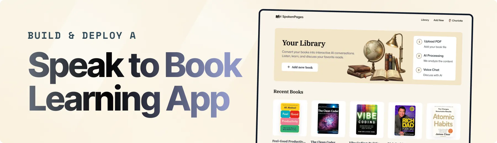
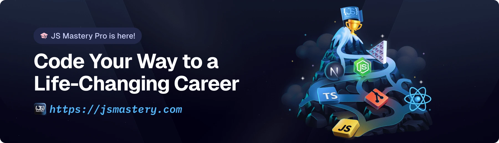

<div align="center">
  <br />
    <a href="https://youtu.be/NiwawEe92Co" target="_blank">
      
    </a>
  <br />

  <div>


<br/>


  </div>

  <h3 align="center">Mentor | AI Study Companion</h3>

   <div align="center">
     Build this project step by step with our detailed tutorial on <a href="https://www.youtube.com/watch?v=XUkNR-JfHwo" target="_blank"><b>JavaScript Mastery</b></a> YouTube. Join the JSM family!
    </div>
</div>

## UI theme and course workspace

The app uses the Mentor brand and a Navy Blue and Dark Gold theme. The official wordmark is `public/assets/mentor.png`; the square emblem used by navigation and app icons is `public/assets/mentor-icon.png`. The chat assistant identifies as Mentor AI, product-facing version Mentor 0.1; this is not a claim about independent foundation-model development. Tokens live in `app/globals.css` (`--navy-*`, `--gold`, `--ink*`); legacy hex utility classes are remapped there. The course page (`components/CourseStudyPage.tsx`) is a chat-first workspace with a grouped sidebar (`components/CourseWorkspaceNav.tsx`): Mentor AI chat, Materials, Course outline, Revision plan, Practice questions, Flashcards, and a Study progress link. On screens below `lg` the sidebar becomes a drawer opened from the menu button; it closes on selection, Escape or overlay click. Animations are CSS-only and respect `prefers-reduced-motion`.

## 📋 <a name="table">Table of Contents</a>

1. ✨ [Introduction](#introduction)
2. ⚙️ [Tech Stack](#tech-stack)
3. 🔋 [Features](#features)
4. 🤸 [Quick Start](#quick-start)
5. 🔗 [Assets](#links)
6. 🚀 [More](#more)

## 🚨 Tutorial

This repository contains the code corresponding to an in-depth tutorial available on our YouTube channel, <a href="https://www.youtube.com/@javascriptmastery/videos" target="_blank"><b>JavaScript Mastery</b></a>.

If you prefer visual learning, this is the perfect resource for you. Follow our tutorial to learn how to build projects like these step-by-step in a beginner-friendly manner!

<a href="https://youtu.be/NiwawEe92Co" target="_blank"></a>

## <a name="introduction">✨ Introduction</a>

Mentor is a text-first AI study companion. Students can organize subjects such as ACC 101 into courses, add PDF, Word, or Excel materials, select one or more sources for a chat, and ask Mentor AI questions grounded in the selected materials. Conversations are saved separately for each exact source selection. The existing book library and Vapi voice-chat experience remain available as a separate feature.

If you're getting started and need assistance or face any bugs, join our active Discord community with over **50k+** members. It's a place where people help each other out.

<a href="https://discord.com/invite/n6EdbFJ" target="_blank"></a>

## <a name="tech-stack">⚙️ Tech Stack</a>

- **[Clerk](https://jsm.dev/books-clerk)** is a comprehensive user management and authentication platform. It provides secure, pre-built components for email and social logins, enabling seamless session management and protected routes with minimal configuration.

- **[CodeRabbit](https://jsm.dev/books-coderabbit)** is an AI-powered code review platform that provides contextual, line-by-line feedback on pull requests. It automates the review process by identifying bugs, suggesting optimizations, and ensuring coding standards are met, significantly reducing the manual effort for developers and improving code quality.

- **[ElevenLabs](https://elevenlabs.io/docs)** is an advanced AI audio platform providing lifelike text-to-speech. It powers the voice previews in Mentor, allowing users to hear and select from a variety of natural-sounding AI personas before starting a conversation.

- **[MongoDB](https://www.mongodb.com/docs/)** is a flexible, document-based NoSQL database designed for scalability and developer ease. Combined with Mongoose, it serves as the core storage for user libraries, book metadata, and conversation transcripts.

- **[Next.js](https://nextjs.org/docs)** is a powerful React framework for building full-stack web applications. It handles the core application logic, server-side rendering, and API routes, enabling a fast and responsive interface for the Mentor platform.

- **[OpenAI](https://developers.openai.com/api/docs)** powers the course tutor. PDFs and extracted text from Word and Excel materials are indexed in OpenAI File Search, and tutor responses retrieve only from selected course materials.

- **[Shadcn UI](https://ui.shadcn.com/)** is a collection of re-usable, accessible components built with Tailwind CSS and Radix UI. It allows for the creation of a clean, modular, and professional-grade user interface that is easy to customize and theme.

- **[TypeScript](https://www.typescriptlang.org/)** is a superset of JavaScript that adds static typing, providing better tooling, code quality, and error detection. It ensures the application remains maintainable and robust as the codebase scales.

- **[Vapi](https://jsm.dev/books-vapi)** powers the existing voice-chat experience for the book library. It is not used by the course tutor.

## <a name="features">🔋 Features</a>

👉 **PDF Upload & Ingestion**: Seamlessly upload PDF books with automated text extraction, intelligent chunking, and high-dimensional embeddings for precise context retrieval.

👉 **Course-Based Study**: Organize subjects and add PDF, `.doc`, `.docx`, `.xls`, or `.xlsx` files to a course. Select several materials when a question needs multiple sources.

👉 **Course-Material-Grounded Mentor AI Chat**: Ask questions in a persistent text chat, get step-by-step academic explanations, and see the selected source material used for answers.

👉 **Conversation History & Learning Memory**: Revisit previous chats for each material; Mentor periodically saves a concise learning memory to personalize future explanations.

👉 **Multi-Material Mentor AI Chat**: Select individual sources or all course materials. Each source selection has its own saved conversation; retrieval is limited to relevant sections with a maximum of 20 results per question.

👉 **Course and Material Management**: Rename courses, delete individual materials, or delete a course with its materials, private originals, OpenAI-indexed files, and saved tutor history.

👉 **AI Practice Quizzes**: Generate assessment-mode quizzes from one or more selected course materials, optionally provide lecturer-style examples, save answers as you work, submit for deterministic objective scoring and AI-assisted written feedback, then review saved attempts. Generation is limited to five quizzes per course per hour and 20 questions per quiz.

👉 **Course Flashcards and Spaced Repetition**: Create course-owned decks, generate source-grounded cards from selected PDF, Word, or Excel materials, preview and select generated cards, create cards manually, and convert missed quiz questions into cards. Review due cards or study a whole deck, reveal answers during review, and save each recall rating and review event.

Flashcard generation is limited to five requests per course per hour and 30 cards per request. Review scheduling uses the standard SM-2 algorithm rather than FSRS: Again maps to quality 0, Hard to 3, Good to 4, and Easy to 5. Successful intervals follow SM-2 (one day for the first successful review, six days for the second, then the previous interval multiplied by the updated ease factor and rounded to a whole day). Again resets repetitions and schedules another review in one day. The minimum ease factor is 1.3 and the maximum interval is 36,500 days as a date-range safeguard. Review instants and interval additions use UTC, avoiding dependence on a student's local timezone. A review event and schedule update are saved together transactionally; retries use an idempotency key. Studying a card without rating it does not change its schedule.

Decks, cards, and review events are stored separately so card lists and history can grow independently. Cards keep source-title snapshots; deleting an individual material marks its source unavailable without invalidating the card. Deleting a deck removes its cards and review history, while deleting a course removes all of its flashcard data.

👉 **Course Outline and Coverage**: From a course page, students can explicitly generate a topic outline after selecting materials, or create one manually. OpenAI File Search is filtered to the selected material IDs; each generated topic and subtopic must map citations to passages actually retrieved. Students can edit and reorder topics, associate course materials, and mark main topics not started, in progress, or completed. Coverage is the share of main topics marked completed; it is a self-reported study-status measure, not quiz performance or mastery.

Course outlines, editable topics, and source snapshots are stored in a course-owned MongoDB collection. Temporary generated previews expire after 24 hours, and an in-progress generation lock prevents simultaneous requests for the same course. Outline generation currently accepts up to 30 selected materials, retrieves at most 50 File Search results, and caps structured model output at 8,000 tokens. If selected files produce no retrieved passages, generation is stopped; if only some selected files are retrieved, students must explicitly confirm before saving that partial outline. Replacing an existing outline requires confirmation; matching topic names retain their IDs and study statuses. Deleted materials remain as unavailable source snapshots and do not provide access to the deleted file.

### Personalized revision planner

👉 **Revision Plan**: On a course page, students with an outline can select “Create Revision Plan”, enter an exam date (kept free of study) or a target completion date, choose the weekdays they can study with minutes per day (30–480, in 5-minute steps), and optionally prioritize topics. A preview shows the generated schedule and why topics are ordered as they are before anything is saved. Tasks are grouped as overdue, today, upcoming and completed, or viewed day by day; students can complete, reopen or reschedule tasks, and update a plan.

Scheduling is deterministic and uses no AI calls (`lib/revision-plan.ts`, with data loading in `lib/revision-plan-server.ts`). Topics come from the course outline. Each topic is scored from its study status, quiz accuracy (at least three graded questions are needed before a topic counts as weak or strong), flashcard due and difficult-review counts, and student priority. Not-started and weak topics are scheduled first; completed topics are still revised and are never treated as mastered. Tasks (study or review, practice, flashcards, revision, quiz) have fixed estimates and are placed in learn → practice → revise order, on later days than the previous stage of the same topic, without exceeding a day's limit. If everything cannot fit, the preview reports the shortfall and the student must explicitly accept a partial plan. Updating a plan keeps completed tasks and replaces pending ones after confirmation. Rescheduling rejects past dates, non-study days, dates outside the window and over-full days (with suggested open days; going over the limit needs explicit confirmation and is flagged on the task).

Plans are stored in the `RevisionPlan` collection (embedded tasks, maximum five plans per course) and are deleted with the course. API: `GET/POST /api/courses/:courseId/revision-plans`, `GET/PATCH/DELETE …/revision-plans/:planId` and `PATCH …/revision-plans/:planId/tasks/:taskId`. Dates are stored as `YYYY-MM-DD` strings; the browser sends its local date, which the server accepts only within one day of its own UTC date. Tests: `node --experimental-strip-types --test tests/revision-plan.test.mjs`.

### Office material extraction

Excel worksheets are indexed as separate, location-labelled tables rather than isolated cell values. Extraction preserves row and column relationships, merged section headings, displayed number formats when available, formulas, and cached formula results without recalculating formulas. Empty worksheets are identified, while workbooks with no readable cell content are rejected. `.doc` and `.docx` continue to use the existing Word text extractors.

This is text extraction, not spreadsheet rendering: embedded charts, diagrams, images, and complex visual layouts are not interpreted, so important visual information may need to be added to the material as text. OpenAI File Search receives the extracted Office text through the existing private upload and vector-store indexing flow.

👉 **Book Voice Conversations**: Engage in real-time voice dialogues with books in the existing library using Vapi.

👉 **AI Voice Personas**: Choose from a variety of distinct AI personalities and hear instant high-fidelity previews powered by ElevenLabs to find the perfect reading companion.

👉 **Smart Summaries & Insights**: Quickly extract the essence of any chapter or request deep-dive summaries, making long-form content more accessible and digestible.

👉 **Session Transcripts**: Keep a complete record of every vocal interaction with auto-generated text transcripts, ensuring you never lose a key insight from your discussions.

👉 **Library Management**: Effortlessly organize and search through your personal uploads or the global collection with a high-performance search interface.

👉 **Auth & Subscription**: Secure user access via email and social login, paired with a robust billing system to manage premium features and platform subscriptions.

And many more, including code architecture and reusability.

## <a name="quick-start">🤸 Quick Start</a>

Follow these steps to set up the project locally on your machine.

**Prerequisites**

Make sure you have the following installed on your machine:

- [Git](https://git-scm.com/)
- [Node.js](https://nodejs.org/en)
- [npm](https://www.npmjs.com/) (Node Package Manager)

**Cloning the Repository**

```bash
git clone https://github.com/adrianhajdin/jsm_bookified.git
cd jsm_bookified
```

**Installation**

Install the project dependencies using npm:

```bash
npm install
```

**Set Up Environment Variables**

Create a new file named `.env` in the root of your project and add the following content:

```env
NODE_ENV='development'
NEXT_PUBLIC_BASE_URL=

# CLERK
NEXT_PUBLIC_CLERK_PUBLISHABLE_KEY=
CLERK_SECRET_KEY=
NEXT_PUBLIC_CLERK_SIGN_IN_URL=/sign-in
NEXT_PUBLIC_CLERK_SIGN_UP_URL=/sign-up
NEXT_PUBLIC_CLERK_SIGN_IN_FALLBACK_REDIRECT_URL=/
NEXT_PUBLIC_CLERK_SIGN_UP_FALLBACK_REDIRECT_URL=/

# VERCEL BLOB
BOOKIFY_PRIVATE_READ_WRITE_TOKEN=
BLOB_READ_WRITE_TOKEN=

# MONGODB
MONGODB_URI=

# OPENAI
OPENAI_API_KEY=

# VAPI
NEXT_PUBLIC_VAPI_API_KEY=
VAPI_SERVER_SECRET=

# Google Gemini API for embeddings
GOOGLE_GEMINI_API_KEY=

# ELEVENLABS
ELEVENLABS_API_KEY=
```

Replace the placeholder values with your real credentials. The course tutor requires an OpenAI API key with API billing enabled; add it as `OPENAI_API_KEY` in `.env.local`. Get an API key from the [OpenAI API Platform](https://platform.openai.com/api-keys). API usage is billed separately from a ChatGPT subscription.

Course PDFs are sent to OpenAI for File Search indexing and remain in OpenAI storage for tutor retrieval. Word and Excel files are converted to searchable text for indexing; their originals stay in private Vercel Blob storage so students can download them. The app serves course files through authenticated routes. Set `BOOKIFY_PRIVATE_READ_WRITE_TOKEN` for the private course-material store. The legacy `/api/upload` endpoint continues to use `VERCEL_BLOB_READ_WRITE_TOKEN` or `BLOB_READ_WRITE_TOKEN` for public book-library uploads. Set `BOOKIFY_PRIVATE_READ_WRITE_TOKEN` to the read-write token for the private Blob store; the course upload flow uses this token in preference to the legacy `BLOB_READ_WRITE_TOKEN`. The store ID is not needed by the app.

You can get the other credentials by signing up at: [**Clerk**](https://clerk.com), [**Vercel**](https://vercel.com), [**MongoDB**](https://www.mongodb.com), [**Vapi**](https://vapi.ai), [**Google AI Studio**](https://aistudio.google.com), [**ElevenLabs**](https://elevenlabs.io).

**Running the Project**

```bash
npm run dev
```

Open [http://localhost:3000](http://localhost:3000) in your browser to view the project.

## <a name="links">🔗 Assets</a>

Assets and snippets used in the project can be found in the **[video kit](https://jsmastery.com/video-kit/8127ec28-61db-4295-a85b-c649df6ee408)**.

<a href="https://jsmastery.com/video-kit/8127ec28-61db-4295-a85b-c649df6ee408" target="_blank">
  
</a>

## <a name="more">🚀 More</a>

**Advance your skills with Next.js Pro Course**

Enjoyed creating this project? Dive deeper into our PRO courses for a richer learning adventure. They're packed with
detailed explanations, cool features, and exercises to boost your skills. Give it a go!

<a href="https://jsm.dev/books-jsm" target="_blank">
  
</a>
# Mentor

